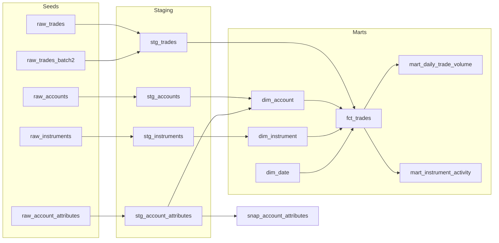

# dbt Analytics Warehouse

**Made by Rahul Ega** · [GitHub repo](https://github.com/Rahul9121/dbt-analytics-warehouse) · [Profile](https://github.com/Rahul9121)

I built this as a small, self-contained dimensional warehouse for capital-markets style trade data. It runs on **dbt** with the **DuckDB** adapter. Everything is seeded CSV — no downloads, no API keys, and a full build finishes in well under a minute on a laptop.

Live docs (lineage graph included): [https://rahul9121.github.io/dbt-analytics-warehouse/](https://rahul9121.github.io/dbt-analytics-warehouse/)

## What it contains

- **Seeds / sources** — accounts, instruments, trades (batch 1 + batch 2), account risk attributes
- **Staging** — `stg_accounts`, `stg_instruments`, `stg_trades`, `stg_account_attributes`
- **Core marts** — `dim_account`, `dim_instrument`, `dim_date`, incremental `fct_trades`
- **Snapshot (SCD2)** — `snap_account_attributes` on risk rating / tier / PM
- **Metrics marts** — `mart_daily_trade_volume`, `mart_instrument_activity`
- **Tests** — unique, not_null, relationships, accepted_values, plus two singular tests
- **CI** — GitHub Actions runs both batches, tests, generates docs, publishes to GitHub Pages

## Lineage



## Run locally (3 commands)

```bash
python -m venv .venv
# Windows: .\.venv\Scripts\Activate.ps1
# macOS/Linux: source .venv/bin/activate
pip install -r requirements.txt
```

```bash
dbt deps --profiles-dir .
dbt build --profiles-dir .
```

Or use the Makefile (batch 2 + snapshot included):

```bash
make setup
make build
make docs
```

`profiles.yml` is committed on purpose so DuckDB works out of the box. Point `profiles.yml` at Snowflake (or another adapter) if you want — I only tested DuckDB.

### Second batch (incremental + SCD2)

```bash
cp data_batches/raw_account_attributes_v2.csv seeds/raw_account_attributes.csv
dbt seed --select raw_trades_batch2 raw_account_attributes --profiles-dir .
dbt run --select stg_account_attributes stg_trades fct_trades mart_daily_trade_volume mart_instrument_activity --vars '{"load_batch_2": true}' --profiles-dir .
dbt snapshot --profiles-dir .
# restore original attributes seed
cp data_batches/raw_account_attributes_v1_restore.csv seeds/raw_account_attributes.csv
```

## Real results (local DuckDB run)

| Resource | Count |
| --- | --- |
| Models | 10 |
| Seeds | 5 |
| Snapshots | 1 |
| Data tests | 61 (all passed) |

| Table | Batch 1 rows | After batch 2 |
| --- | --- | --- |
| `fct_trades` | 40 | 50 |
| `snap_account_attributes` | 8 | 10 |
| `dim_account` | 8 | 8 |
| `dim_instrument` | 10 | 10 |
| `dim_date` | 91 | 91 |
| `mart_daily_trade_volume` | 39 | 49 |
| `mart_instrument_activity` | 10 | 10 |

Batch 2 adds trades T0041–T0050. The snapshot grows from 8 to 10 rows because ACC001 and ACC005 change risk rating / tier (SCD type 2 closes the old version and opens a new one).

## Project layout

```
models/staging/     sources + stg_* views
models/marts/core/  dimensions + fct_trades
models/marts/metrics/
snapshots/          snap_account_attributes
seeds/              CSV inputs
data_batches/       second-pass attribute file
tests/              singular tests
docs/               overview page for dbt docs
.github/workflows/  CI + Pages deploy
```

## Pointing at Snowflake

Swap the adapter in `requirements.txt` / `profiles.yml` (for example `dbt-snowflake`) and set account, warehouse, database, and schema. Model SQL is mostly standard. I did not run this project against Snowflake — treat that path as untested.

## Limitations

- Synthetic data only; not production market data
- DuckDB file backend; no multi-user concurrency story
- Date dimension is a fixed Q1 2024 spine
- Incremental strategy is `delete+insert` on `trade_id` filtered by `max(trade_ts)` — fine for this demo, not a full late-arriving-data design
- Snapshot demo mutates the attributes seed on the second pass (restored afterward)

## License

MIT. See [LICENSE](LICENSE).
